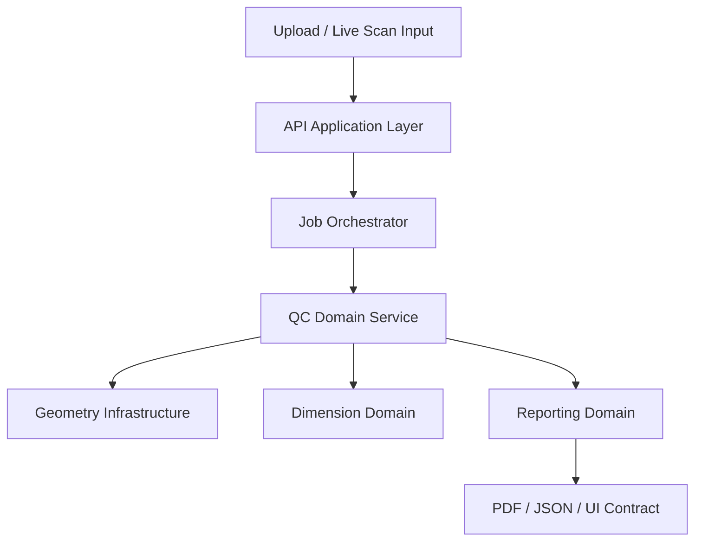
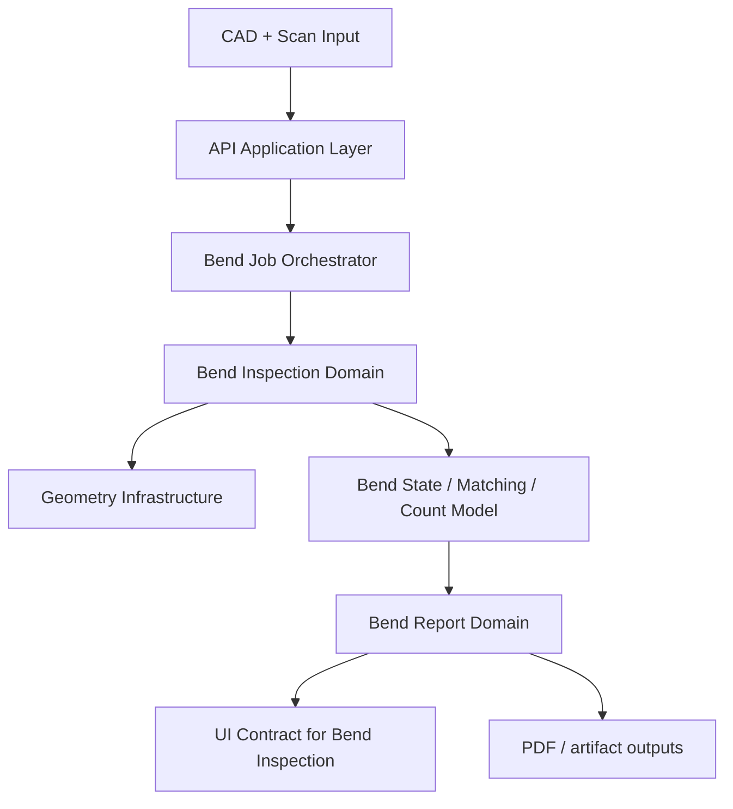
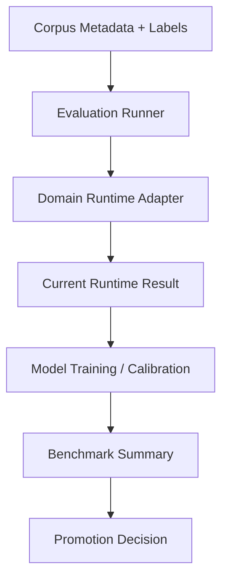

# Sherman QC Enterprise Re-Architecture Plan

## Executive Summary

Sherman QC has crossed the point where feature velocity alone is a good architecture strategy.
The product now contains:
- a general QC workflow
- a bend-inspection workflow
- live scan / session orchestration
- AI/reporting pipelines
- a labeled bend corpus and research tooling

Those capabilities are valuable, but they are currently too interwoven.

The correct move is **not** a big-bang rewrite. The correct move is a staged re-architecture that:
- preserves behavior
- isolates domain modules
- separates product runtime from research tooling
- gives the frontend stable contracts
- makes the geometry/bend/runtime stack testable as independent units

This document proposes that target architecture and the migration order.

---

## 1. Current Diagnosis

### 1.1 The real issues

The main maintainability problems are structural, not cosmetic.

1. `backend/server.py` is carrying too many responsibilities.
- API endpoints
- upload handling
- worker orchestration
- auth wiring
- file serving
- part catalog glue
- bend inspection glue
- report delivery

2. Bend logic is split across multiple layers with overlapping semantics.
- `backend/bend_detector.py`
- `backend/feature_detection/bend_detector.py`
- `backend/bend_inspection_pipeline.py`
- `backend/bend_analysis_worker.py`
- `backend/bend_unary_model.py`

3. Product runtime and research/runtime-improvement tooling live too close together.
- `scripts/evaluate_bend_corpus.py`
- `scripts/train_bend_unary_models.py`
- `scripts/annotate_bend_unary_predictions.py`
- `data/bend_corpus/...`

4. The frontend 3D viewer carries too many roles in one component.
- geometry loading
- transform normalization
- heatmap rendering
- CAD/scan toggles
- bend annotation display
- callout layout
- camera focus logic
- interaction state

5. API contracts are not isolated enough from backend internals.
- page code and worker outputs evolve together too tightly
- there is a real risk of accidental coupling between runtime data shape and UI implementation details

6. The repo still mixes “source of truth” code with operational/runtime concepts.
Even though generated artifacts were cleaned from git, the **conceptual architecture** still mixes:
- source code
- runtime output assumptions
- experiment logic
- research benchmark logic

### 1.2 Concrete hotspots

These are the highest-value refactor targets:
- `backend/server.py`
- `backend/bend_inspection_pipeline.py`
- `backend/qc_engine.py`
- `backend/pdf_generator.py`
- `frontend/react/src/components/ThreeViewer/index.tsx`
- `frontend/react/src/pages/BendInspection.tsx`
- `frontend/react/src/services/api.ts`

### 1.3 What “enterprise-level” should mean here

For this project, enterprise-level does **not** mean adding framework ceremony.
It means:
- clear module boundaries
- stable contracts
- isolated domain logic
- observable workflows
- deterministic regression gates
- docs that match the code
- an architecture that supports both product delivery and algorithm research without corrupting either

---

## 2. Architectural Principles

1. **Product runtime and research tooling must be separate first-class layers.**
2. **One domain capability = one primary home.**
3. **API handlers should orchestrate, not implement domain logic.**
4. **3D rendering should be a presentation module, not a data-assembly engine.**
5. **Typed contracts should mediate backend ↔ frontend, runtime ↔ worker, product ↔ research.**
6. **No hidden behavior in scripts.** Anything operationally important should live in a service/module with tests.
7. **Refactor by strangler pattern, not rewrite-in-place.**

---

## 3. Proposed Target Architecture

## 3.1 Top-level structure

```text
Full Project/
├── apps/
│   ├── api/                     FastAPI app, route registration, dependency wiring
│   ├── worker/                  Background job runners and orchestration entrypoints
│   └── web/                     React app
├── domains/
│   ├── qc/                      General scan-vs-CAD analysis domain
│   ├── bend/                    Bend inspection domain
│   ├── dimensions/              Dimension/spec parsing and comparison
│   ├── reporting/               Report assembly and export contracts
│   ├── catalog/                 Part catalog and live-session domain
│   └── auth/                    Authentication and authorization domain
├── infrastructure/
│   ├── geometry/                Open3D, trimesh, importers, mesh/point-cloud utilities
│   ├── persistence/             DB, file storage, repositories
│   ├── ai/                      AI orchestration and provider adapters
│   ├── queue/                   Worker/job transport layer
│   └── telemetry/               Logging, metrics, tracing
├── contracts/
│   ├── api/                     HTTP request/response schemas
│   ├── jobs/                    Worker payload and result schemas
│   └── ui/                      Shared frontend-facing result shapes
├── research/
│   ├── corpus/                  Corpus metadata and labels
│   ├── evaluation/              Evaluators and benchmark runners
│   ├── models/                  Unary/structured modeling code
│   └── docs/                    Research notes and benchmark writeups
├── docs/
├── tests/
└── scripts/                     Thin operational wrappers only
```

This can be introduced gradually while keeping the current repo path structure alive during migration.

## 3.2 Runtime flow ownership

### General QC flow



### Bend inspection flow



### Research loop flow



The key rule is:
- **research reuses runtime through adapters/contracts**
- runtime does **not** depend on ad hoc research scripts

---

## 4. Domain Boundaries

## 4.1 Bend domain

This should become the cleanest domain in the system because it is the most actively evolving and the most research-sensitive.

### Bend domain submodules

```text
domains/bend/
├── application/
│   ├── analyze_bend_job.py
│   ├── list_bend_jobs.py
│   └── export_bend_report.py
├── model/
│   ├── bend_spec.py
│   ├── bend_match.py
│   ├── bend_report.py
│   ├── bend_observability.py
│   ├── bend_assignment.py
│   └── bend_count.py
├── services/
│   ├── cad_baseline_service.py
│   ├── scan_bend_detection_service.py
│   ├── bend_matching_service.py
│   ├── bend_state_service.py
│   ├── bend_count_service.py
│   └── bend_report_service.py
├── ports/
│   ├── geometry_port.py
│   ├── bend_repository.py
│   └── artifact_store.py
└── mappers/
    ├── api_mapper.py
    └── worker_mapper.py
```

### Critical design rule

The bend domain should own:
- CAD baseline determination
- scan bend evidence
- observability
- assignment
- count decoding
- report-ready bend summaries

It should **not** own:
- HTTP transport
- file upload mechanics
- raw DB implementation
- React annotation layout

## 4.2 Geometry infrastructure

All raw mesh/point-cloud operations should be concentrated into one infrastructure layer.

Examples:
- file import
- mesh normalization
- ICP/alignment primitives
- clipping utilities
- point-cloud statistics
- CAD BREP/STL/PLY loaders
- local neighborhood extraction

This reduces duplication between:
- `qc_engine.py`
- `cad_dimension_extractor.py`
- `bend_inspection_pipeline.py`
- `feature_detection/*`

## 4.3 Reporting domain

Currently reporting logic is spread across:
- `pdf_generator.py`
- `bend_report_generator.py`
- server response assembly
- UI-side presentation assumptions

Target:
- one reporting domain with:
  - report model
  - report assembler
  - export adapters

So the UI, PDF, and JSON all derive from the same report contract.

---

## 5. Frontend Re-Architecture

## 5.1 Current issue

`frontend/react/src/components/ThreeViewer/index.tsx` is doing too much. It is effectively a rendering engine, scene controller, callout layout engine, and interaction manager in one file.

That is not sustainable.

## 5.2 Target frontend feature structure

```text
frontend/react/src/
├── app/
│   ├── router/
│   ├── providers/
│   └── layout/
├── features/
│   ├── bend-inspection/
│   │   ├── api/
│   │   ├── components/
│   │   ├── hooks/
│   │   ├── model/
│   │   ├── mappers/
│   │   └── pages/
│   ├── live-scan/
│   ├── qc-jobs/
│   ├── reports/
│   └── part-catalog/
├── shared/
│   ├── api/
│   ├── ui/
│   ├── 3d/
│   ├── utils/
│   └── types/
```

## 5.3 ThreeViewer target decomposition

Break `ThreeViewer` into explicit modules:

```text
shared/3d/
├── loaders/
│   ├── useModelGeometry.ts
│   └── useReferenceGeometry.ts
├── scene/
│   ├── ViewerCanvas.tsx
│   ├── ViewerCameraController.tsx
│   └── ViewerToggles.tsx
├── overlays/
│   ├── HeatmapOverlay.tsx
│   ├── BendLineOverlay.tsx
│   ├── BendCalloutOverlay.tsx
│   ├── ExtremeDeviationOverlay.tsx
│   └── CadScanOverlay.tsx
├── bend-annotations/
│   ├── annotationMapper.ts
│   ├── annotationLayout.ts
│   ├── annotationFocus.ts
│   └── annotationContracts.ts
└── index.ts
```

### Specific note on your recent bend-annotation UI changes

Covered explicitly.

The bend annotation assembly should move into a dedicated frontend feature module, not stay embedded inside the base viewer.

That means your current 3D render changes belong in the future boundary:
- `features/bend-inspection/model/annotationMapper.ts`
- `shared/3d/overlays/BendLineOverlay.tsx`
- `shared/3d/overlays/BendCalloutOverlay.tsx`
- `shared/3d/scene/ViewerCameraController.tsx`

So yes: **your recent bend-annotation changes are covered by this plan**.
They should be preserved, but moved behind a clearer boundary.

---

## 6. Backend Re-Architecture

## 6.1 API layer

`backend/server.py` should be split into route modules and app wiring.

Target:

```text
apps/api/
├── main.py
├── dependencies/
├── routes/
│   ├── auth.py
│   ├── analysis.py
│   ├── bend_inspection.py
│   ├── jobs.py
│   ├── reports.py
│   ├── live_scan.py
│   └── part_catalog.py
└── schemas/
```

API handlers should:
- validate input
- call application services
- map domain results to HTTP schemas
- not perform domain logic inline

## 6.2 Worker/orchestration layer

Current workers and runtime orchestration should be made explicit.

Target responsibilities:
- job submission
- runtime config resolution
- worker launch / retry / status
- artifact persistence
- lifecycle telemetry

This avoids embedding worker concerns in API handlers.

## 6.3 Bend domain cleanup priorities

### Highest-value cleanup

1. Unify bend-runtime semantics
- remove ambiguity between:
  - `backend/bend_detector.py`
  - `backend/feature_detection/bend_detector.py`
- choose one primary detector domain model

2. Split `bend_inspection_pipeline.py`
Current file is a catch-all.
It should be broken into:
- geometry loading adapter
- CAD baseline service
- scan evidence service
- matching/state service
- report assembler

3. Promote contracts
- define stable `BendInspectionResult`, `BendMatchResult`, `StructuredCountResult`
- use those contracts across API, worker, UI, evaluator

---

## 7. Redundancy and Duplication Cleanup

## 7.1 Known redundancy classes

1. Duplicate bend detection semantics
2. Overlapping report generation code
3. Repeated geometry import/normalization logic
4. Runtime-vs-script duplication
5. UI-side assembly of domain-shaped data

## 7.2 Rule for removal

No “cleanup” should be done by hand-waving.
Each duplicate must be classified as one of:
- canonical implementation
- compatibility shim
- dead code scheduled for removal

Every compatibility shim should have an expiry issue or migration note.

---

## 8. Documentation System

## 8.1 What good documentation should look like here

You need four documentation classes, each with a different audience.

1. **Repo entry docs**
- `README.md`
- how to run the product
- where to start reading
- repo policy

2. **Architecture docs**
- system context
- module boundaries
- processing flows
- contracts

3. **Operator/product docs**
- how Bend Inspection works
- how Live Scan works
- report interpretation

4. **Research/benchmark docs**
- corpus description
- benchmark protocol
- current model direction
- promotion criteria

## 8.2 Documentation target tree

```text
docs/
├── architecture/
│   ├── system-overview.md
│   ├── runtime-flows.md
│   ├── backend-modules.md
│   ├── frontend-modules.md
│   └── contracts.md
├── product/
│   ├── bend-inspection.md
│   ├── live-scan.md
│   └── reports.md
├── research/
│   ├── corpus-data-card.md
│   ├── regression-framework.md
│   ├── bend-state-model.md
│   └── benchmark-history.md
└── operations/
    ├── local-dev.md
    ├── deployment.md
    └── troubleshooting.md
```

---

## 9. Testing Strategy

## 9.1 Required test pyramid

### Unit tests
- geometry utilities
- bend state transforms
- parser logic
- contract mappers
- count decoding

### Domain/service tests
- bend inspection service
- report assembly service
- live scan session service

### Contract tests
- backend API schema to frontend client expectations
- worker payload/result schemas

### Regression tests
- corpus evaluator on frozen subsets
- structured count benchmark
- staged progression benchmark

### UI tests
- page-level flows
- Bend Inspection panel logic
- 3D overlay smoke tests via Playwright

## 9.2 Rule

No domain refactor should happen without first freezing behavior through tests at the seam being moved.

---

## 10. Migration Plan

## Wave 0: Freeze seams

Goal:
- stop architecture erosion before refactor starts

Actions:
- define explicit contracts for:
  - bend inspection result
  - structured count result
  - report summary result
- add route/service boundaries in documentation first
- identify canonical bend detector path

Deliverables:
- architecture ADRs
- contract schemas
- file ownership map

## Wave 1: Extract API and application layers

Goal:
- shrink `backend/server.py`

Actions:
- move route groups into app modules
- introduce application services for:
  - analysis jobs
  - bend jobs
  - reports
  - live scan
- keep current runtime logic behind application services initially

Success criteria:
- `server.py` becomes bootstrap + router registration only

## Wave 2: Extract bend domain

Goal:
- make bend inspection a coherent subsystem

Actions:
- split `bend_inspection_pipeline.py`
- unify detector semantics
- move structured count logic into bend domain services
- expose stable bend result contracts

Success criteria:
- evaluator, worker, API, and UI all consume the same bend-domain contract

## Wave 3: Extract frontend features

Goal:
- make the UI maintainable and safe to evolve

Actions:
- move page-specific logic into `features/*`
- split `ThreeViewer`
- isolate bend annotation mapping/layout/focus logic
- isolate API adapters from page components

Success criteria:
- Bend Inspection UI can evolve without modifying the generic viewer core for every change

## Wave 4: Separate research from product runtime

Goal:
- preserve research power without polluting runtime

Actions:
- move corpus/evaluator/model code into `research/`
- keep shared domain adapters in stable interfaces
- scripts become thin wrappers, not hidden business logic

Success criteria:
- product runtime can ship independently from ongoing algorithm experiments

## Wave 5: Reporting and artifact unification

Goal:
- one report model, many outputs

Actions:
- unify JSON/PDF/UI reporting contracts
- centralize artifact metadata
- remove duplicate bend/report shape assembly

Success criteria:
- UI and PDF disagree only if there is an explicit rendering bug, not because they use different data assembly paths

---

## 11. My Practical Take

If the goal is “enterprise-level,” the biggest shift is this:

**stop thinking of the codebase as one app with many files, and start thinking of it as several domains sharing infrastructure and contracts.**

The most dangerous current architectural mistakes are:
- monolithic API composition
- bend-domain logic spread across too many files
- UI components carrying domain assembly responsibilities
- research/runtime coupling without a strong contract boundary

The best path is:
- staged refactor
- contract-first
- domain extraction around bend inspection first
- frontend feature modularization second
- research/runtime separation third

Not the other way around.

---

## 12. Recommended Immediate Next Actions

1. Write an ADR that declares the target domain boundaries.
2. Define and freeze the bend inspection result contract.
3. Split `backend/server.py` into route modules and application services.
4. Split `ThreeViewer` into scene, overlays, and bend-annotation modules.
5. Move bend-specific frontend data assembly out of the generic viewer.
6. Classify every duplicate bend/report module as canonical, shim, or dead code.
7. Reorganize docs into repo-entry, architecture, product, and research sections.

If done in that order, the project can become much easier to maintain without losing velocity or breaking the current product/research loop.
