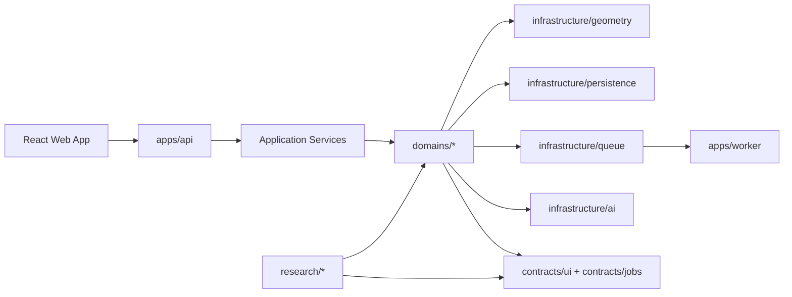

# System Overview

Sherman QC is being reordered with a strangler migration. The current goal is to preserve existing behavior while moving the codebase toward explicit application, domain, infrastructure, contract, and research layers.

## Target runtime shape

## Migration rules
- preserve current product behavior
- move code behind stable contracts before deleting legacy entrypoints
- keep research tooling available, but separate from operator/runtime paths
- use compatibility shims explicitly while modules move

## Current first extracted domain
The bend-inspection path is the first domain being extracted because it carries the heaviest mix of runtime logic, reporting, UI semantics, and research code.
