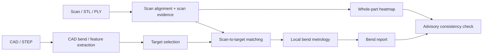

# Sherman QC: Technical Memo For Professor Review

## Purpose
This document is meant to make the current technical situation legible quickly, so your answers can be concrete and directly useful.

We are not looking for general research direction only.
We are looking for decisions that can change:
- target definitions
- alignment policy
- local measurement policy
- labeling policy
- benchmark design

Where useful, I included the **expected answer structure** so we can convert your response directly into implementation and evaluation changes.

---

## 1. What the system is trying to do
We are building a CAD-vs-scan quality-control system for sheet-metal parts.

Current scope includes:
- detection and counting of bends
- determining which bends are completed on partial scans
- comparing formed bends on scan vs CAD
- special handling for rolled sections
- UI overlay of CAD, scan, bend targets, and process features
- full-part heatmap comparison between aligned scan and CAD

The intended end-state is not just bend counting.
It is a system that can do all of the following reliably:
1. align CAD and scan
2. localize each countable bend target
3. decide whether it is formed
4. compare it to the CAD baseline
5. separate rolled/process features from countable discrete bends
6. remain meaningful on partial as well as full scans

---

## 2. Current system shape
### 2.1 Current pipeline, simplified


### 2.2 Current system strengths
We now have:
- a stable core benchmark path for bend MAE
- explicit separation between:
  - countable discrete bends
  - rolled/process features
- better contract boundaries in the codebase
- a usable advisory bend-vs-heatmap consistency layer
- better UI semantics than before

### 2.3 Current system weaknesses
The main remaining failures are not architectural. They are definitional and geometric.

The hardest ones are:
1. ambiguous target definition on hybrid parts
2. wrong local frame for bend comparison even when global overlay looks good
3. weak handling of rolled sections
4. uncertain truth source for expected bend angle when CAD/spec/drawing disagree
5. partial-stage alignment and observability uncertainty

---

## 3. Why we need your input now
We have reached the point where further progress depends more on **correct problem definition** than on more engineering effort.

Several of our current difficulties are likely caused by one or more of the following being underspecified:
- what exactly counts as a bend target
- what should be aligned first and by what datum hierarchy
- how rolled sections should be represented and tolerated
- what truth source should define expected bend angle
- what geometry is invariant enough to compare partially completed parts robustly

So the goal of this session is to get crisp answers on these points.

---

## 4. Current empirical status
### 4.1 Core benchmark status
We recently stabilized the **core** corpus benchmark by separating it from the expensive advisory heatmap-consistency path.

Current core baseline:
- scans processed: `34`
- failed scans: `0`
- heuristic MAE vs expected total completed bends: `1.909`
- structured MAE vs expected total completed bends: `1.727`
- heuristic MAE vs expected completed bends: `0.571`
- structured MAE vs expected completed bends: `0.333`
- heuristic partial MAE vs expected total completed bends: `3.6`
- structured partial MAE vs expected total completed bends: `3.6`

Interpretation:
- the system is stable enough to learn from and compare changes against
- structured inference helps on the cleaner/full cases
- partial scans remain the main performance weakness
- hybrid rolled-plus-bend families remain structurally difficult, not just noisy

### 4.2 Important practical lesson
The project is no longer bottlenecked by code organization.
It is bottlenecked by:
- target fidelity
- alignment/datum policy
- observability policy
- better truth labels
- special-family definitions that are currently under-specified

---

## 5. Concrete examples of the difficult cases
### 5.1 Standard folded multi-bend parts
These are the cleaner cases.
They are what the system handles best today.

### 5.2 Partial-stage parts
Here, the main issue is not just bend angle measurement.
It is deciding:
- what can be aligned safely
- what is invariant across stages
- what evidence is sufficient to say a bend is formed
- when continuity across stages is justified versus when it creates false positives

### 5.3 Rolled / hybrid parts
These are the hardest family.
They often contain:
- a rolled shell or curved section
- plus one or more local flange bends

The key problem is that the rolled shell is not the same thing as a countable bend target, but it is still a real process feature that should be represented and validated somehow.

This creates ambiguity in:
- target extraction
- alignment
- measurement
- UI presentation
- benchmark interpretation

### 5.4 Two representative failure modes
1. **Rolled-shell + local flange bends**
- We now explicitly separate rolled/process features from countable bends.
- That fixed the semantic error of counting the roll itself as a bend.
- But on these parts we still struggle to:
  - localize the true flange bend targets consistently
  - define the correct expected bend angle source
  - compare scan vs CAD locally in the right frame

2. **Partial-stage overlay**
- Large regions often remain geometrically similar between stages.
- The unsolved question is which of those regions are safe enough to use as datums.
- This directly affects:
  - bend-completion inference
  - stage-to-stage consistency
  - whether local deltas are meaningful at all

### 5.5 Heatmap note
- We do have a bend-vs-heatmap advisory validator now.
- It is useful as a corroboration layer, but it is not treated as ground truth and does not override bend decisions.
- The current question is not whether heatmaps are useful in general.
- The question is **when bend-local metrology and heatmap residuals should be expected to agree, and when they should not**.

---

## 6. What we need from you
Below are the highest-value technical questions.

For each one, I included:
- why it matters
- what decision it unlocks
- the answer format that would be most useful to us

The formatting is deliberate: if you answer in roughly this structure, we can convert your response directly into implementation choices.

If you disagree with the framing of the problem itself, that is also useful.
In that case, the most valuable response is:
- what we are modeling incorrectly
- what variable or definition should replace it
- which current benchmark metric becomes misleading as a result

---

## Question 1: Canonical bend target definition
### Question
What is the canonical definition of a **bend target** for this system?

We need a rule that separates every relevant feature into one of these classes:
- `countable discrete bend`
- `rolled/process feature`
- `non-bend transition / geometry detail`

### Why this matters
A large share of current system failure is actually target-definition failure.
Examples:
- rolled sections counted as bends
- shell transitions mistaken for flange bends
- geometry details competing with true bend targets

### This decision would directly change
- corpus labeling
- bend numbering in the UI
- per-family routing in the algorithm
- interpretation of MAE

### Preferred answer format
```yaml
canonical_bend_definition:
  countable_discrete_bend: "..."
  rolled_process_feature: "..."
  non_bend_transition: "..."
  truth_basis:
    choose_one_of:
      - final geometry
      - manufacturing operation
      - drawing callout
  exceptions:
    - family: "..."
      rule: "..."
```

### Hard follow-up
If manufacturing sequence and final geometry disagree, which one should define model truth?

---

## Question 2: Canonical alignment hierarchy
### Question
What should be the canonical alignment hierarchy for CAD-vs-scan comparison?

In particular:
- should drilled holes / slots / punched datums outrank surface ICP?
- should large unchanged flat regions outrank holes when holes are sparse?
- should the hierarchy change for:
  - full finished parts
  - partial-stage parts
  - rolled / hybrid parts

### Why this matters
We can currently have a visually good global overlay but still a wrong local bend-comparison frame.
A better datum hierarchy may simplify the entire system more than additional metrology complexity.

### This decision would directly change
- registration stack design
- local bend frame definition
- partial-stage comparison policy
- whether we should rely more on holes or surfaces

### Preferred answer format
```yaml
alignment_hierarchy:
  full_finished:
    primary: "..."
    secondary: "..."
    tertiary: "..."
  partial_stage:
    primary: "..."
    secondary: "..."
    tertiary: "..."
  rolled_hybrid:
    primary: "..."
    secondary: "..."
    tertiary: "..."
  note_on_holes: "..."
  note_on_flat_regions: "..."
```

### Hard follow-up
If you had to remove one alignment primitive entirely, which one would you remove first and why?
- global ICP
- hole-based alignment
- plane-based alignment
- local feature-to-feature registration

---

## Question 3: Hole and slot overlays as precision anchors
### Question
Can drilled holes / slots / punched openings be treated as the primary local anchor set for finished-part 1:1 overlay accuracy?

If yes:
- what feature quality is required?
- how many are enough?
- which geometries count: circles only, slots too, countersinks too?

### Why this matters
If these features are sufficiently stable, we may be able to simplify local bend pinpointing substantially.

### This decision would directly change
- hole-first alignment mode
- local per-bend frame construction
- how much global surface fitting we really need

### Preferred answer format
```yaml
hole_anchor_policy:
  use_as_primary_for_finished_parts: true_or_false
  allowed_feature_types:
    - circle
    - slot
    - countersink
    - other
  minimum_anchor_count: N
  minimum_spatial_spread_rule: "..."
  known_failure_modes:
    - "..."
```

### Hard follow-up
If hole-based registration and surface-based registration disagree, which one should be trusted?

---

## Question 4: Partial-stage invariant geometry
### Question
For partially completed parts, what geometry should be treated as invariant and safe to align on across stages?

Candidates include:
- large flat plates that remain unchanged
- hole patterns in still-flat regions
- reference edges far from future bend lines
- already completed bends

### Why this matters
A major missing capability is robust overlay of partially completed parts where large areas remain geometrically similar across stages.

### This decision would directly change
- partial-stage alignment masks
- stage-to-stage priors
- observability logic
- continuity rules

### Preferred answer format
```yaml
partial_stage_invariants:
  trusted_region_types:
    - "..."
  avoid_region_types:
    - "..."
  can_use_completed_bends_as_datums: true_or_false
  can_use_unbent_large_flats_as_primary_datums: true_or_false
  stage_to_stage_rule: "..."
```

### Hard follow-up
If only one large flat region remains invariant, is that sufficient, or do we still need discrete datums like holes?

---

## Question 5: Rolled sections — representation
### Question
How should a rolled section be represented mathematically and semantically in the system?

Possibilities include:
- one manufacturing step only
- one geometric feature with radius + arc extent + centerline
- several sampled local sections along the roll
- a separate profile family rather than a bend target

### Why this matters
Rolled sections are currently the hardest family to model correctly.
Treating them as ordinary bends is wrong, but treating them as generic surfaces loses process meaning.

### This decision would directly change
- whether rolled sections get their own pipeline or validator
- whether rolled sections enter bend progress/count metrics
- what UI and reporting should show

### Preferred answer format
```yaml
rolled_section_representation:
  semantic_type: "manufacturing_step | geometric_feature | both"
  countable_in_bend_progress: true_or_false
  primary_parameters:
    - radius
    - arc_extent
    - centerline
    - local_section_shape
    - other
  preferred_comparison_method:
    - local cross-sections
    - full surface residuals
    - centerline fit
    - hybrid
```

### Hard follow-up
If you were allowed only one number and one plot to validate a rolled section, what should they be?

---

## Question 6: Rolled sections — tolerance semantics
### Question
What is the correct tolerance semantics for rolled sections?

Should pass/fail be driven by:
- local radius error
- centerline deviation
- arc extent error
- cross-sectional profile mismatch
- global heatmap
- some combination

### Why this matters
Without a clear tolerance semantics, rolled sections remain visually inspectable but not metrically well-defined.

### Preferred answer format
```yaml
rolled_tolerance_semantics:
  primary_metric: "..."
  secondary_metric: "..."
  when_global_heatmap_is_enough: "..."
  when_local_section_validation_is_required: "..."
  pass_fail_rule: "..."
```

---

## Question 7: Truth source for expected bend angle
### Question
When drawing, process sheet, and final CAD imply slightly different bend angles, which one should define the expected bend angle?

Possible truth sources:
- final CAD included angle
- process-sheet / tooling angle
- drawing callout
- springback-adjusted manufacturing intent

### Why this matters
This is currently one of the main causes of contradiction:
- heatmap says geometry is fine
- local bend metrology says angle is wrong
- both cannot be treated equally without a defined truth source

### Preferred answer format
```yaml
bend_angle_truth_source:
  default_source: "cad | drawing | process_sheet | other"
  if_sources_disagree: "resolution rule"
  springback_handling: "..."
  family_exceptions:
    - family: "..."
      source: "..."
```

### Hard follow-up
If final CAD and scan agree globally but bend angle appears locally wrong, what should we suspect first?
Please rank:
- wrong target definition
- wrong local frame
- wrong expected angle
- actual manufacturing defect

---

## Question 8: Local bend frame definition
### Question
How should the local comparison frame for a bend be defined?

Options:
- CAD bend line + adjacent CAD faces
- local scan planes only
- nearby datums first, then bend line
- section slice orthogonal to bend line

### Why this matters
If the local frame is wrong, local angle/radius deltas are not trustworthy even when the overall overlay looks good.

### Preferred answer format
```yaml
local_bend_frame:
  preferred_frame_definition: "..."
  minimum_geometry_required: "..."
  fallback_if_adjacent_planes_are_short_or_noisy: "..."
  role_of_local_holes_or_slots: "..."
```

---

## Question 9: Distinguishing true bends from shell/profile transitions
### Question
What geometric cues most reliably separate a real flange bend from a shell/profile transition on hybrid parts?

Candidates:
- bend-line length
- adjacent face area ratio
- distance from edge
- distance from rolled centerline
- local section topology
- drawing-callout proximity

### Why this matters
This is the core target-selection problem on hybrid parts like our rolled-plus-flange examples.

### Preferred answer format
```yaml
hybrid_selector_priority:
  strongest_positive_cues:
    - cue: "..."
      weight: high_medium_low
  strongest_negative_cues:
    - cue: "..."
      weight: high_medium_low
  decisive_rule_if_only_one_exists: "..."
```

---

## Question 10: When should heatmap and bend metrology correlate?
### Question
Under what conditions should local bend metrology and local heatmap residuals strongly correlate, and under what conditions should they explicitly not be expected to correlate?

### Why this matters
We already built a bend-vs-heatmap advisory validator, but it only helps if we know when disagreement is meaningful.

### Preferred answer format
```yaml
heatmap_bend_correlation:
  strong_correlation_cases:
    - "..."
  weak_correlation_cases:
    - "..."
  not_expected_to_correlate:
    - "..."
  safest_first_use: "..."
```

### Hard follow-up
Would you ever allow heatmap agreement to overturn a bend failure, or should it only flag for review?

---

## Question 11: Minimum observability for declaring a bend formed
### Question
What minimum evidence should be required before declaring a bend as formed on a partial scan?

Examples:
- one adjacent face visible
- both adjacent faces visible
- local section present
- hole/edge context confirms the frame
- partial evidence is only weak support

### Why this matters
This directly affects false positives on partial scans, which remain one of the biggest MAE drivers.

### Preferred answer format
```yaml
minimum_observability_for_formed:
  required_signals:
    - "..."
  optional_supporting_signals:
    - "..."
  never_enough_on_its_own:
    - "..."
  partial_scan_rule: "..."
```

---

## Question 12: Highest-value new label
### Question
If we can afford only one additional label type in the corpus, what should it be?

Candidates:
- completed bend IDs
- per-bend formed/not formed
- rolled section presence / completion state
- invariant datum regions for partial parts
- good/bad final quality label
- hole-datum confidence label

### Why this matters
We need the highest return per annotation hour.

### Preferred answer format
```yaml
highest_value_new_label:
  label_name: "..."
  why_it_beats_the_others: "..."
  minimum_annotation_format: "..."
  expected_model_gain: "..."
```

---

## Question 13: Breakthrough metric
### Question
If we want one metric that best captures whether the system is becoming industrially useful, what should it be?

Candidates:
- bend-count MAE
- exact completed-bend-set accuracy
- local bend-angle MAE on observable bends
- full-part registration error after datum alignment
- rolled-section pass/fail accuracy
- operator-review save rate

### Why this matters
A lot of roadmap decisions depend on optimizing the right metric.

### Preferred answer format
```yaml
breakthrough_metric:
  primary_metric: "..."
  secondary_metrics:
    - "..."
  why_primary: "..."
  what_not_to_overoptimize_yet:
    - "..."
```

---

## Question 14: Forced simplification
### Question
If you had to simplify the system radically without losing accuracy, what would you simplify first?

Examples:
- rely more on holes and less on global ICP
- rely more on local sections and less on full 3D bend-line fitting
- split rolled families into a separate pipeline
- align partial stages using invariant flats and stop trying to register changing geometry globally

### Why this matters
We want to know whether the current complexity is necessary or just accidental.

### Preferred answer format
```yaml
preferred_simplification:
  remove_or_reduce: "..."
  replace_with: "..."
  why_accuracy_should_not_drop: "..."
  best_part_families_for_trying_it:
    - "..."
```

---

## Question 15: Final forced ranking
### Question
Please rank the following as the biggest remaining blocker to industrial-grade performance:
- target definition
- alignment / datum policy
- partial-scan observability
- rolled-section representation
- local bend-frame definition
- lack of labeled truth
- benchmark design

### Preferred answer format
```yaml
blocker_ranking:
  1: "..."
  2: "..."
  3: "..."
  4: "..."
  5: "..."
  6: "..."
  7: "..."
  rationale: "short explanation"
```

---

## My own blunt view before the discussion
If we get strong answers on only these 4 topics, the project direction changes materially:

1. canonical bend target definition
2. alignment hierarchy, especially holes vs surfaces vs invariant flats
3. rolled section representation and tolerance semantics
4. truth source for expected bend angle when CAD/spec/drawing disagree

Those four answers would immediately change:
- model routing
- label policy
- local metrology
- trust in our current reported bend deltas

The sharpest practical question underneath all of this is:

**What should be considered the authoritative geometric truth for local comparison when final CAD, process intent, drawing callouts, and partial-stage evidence do not all agree?**

---

## Suggested way to answer
A brief answer is fine.
It does not need to be long.

What helps most is:
- choosing a side when alternatives exist
- naming exceptions explicitly
- stating what should be treated as truth when sources disagree
- identifying what should be simplified first
- being explicit about which current assumptions you think are wrong

If time is short, Questions 1, 2, 5, and 7 are the highest-yield ones.
